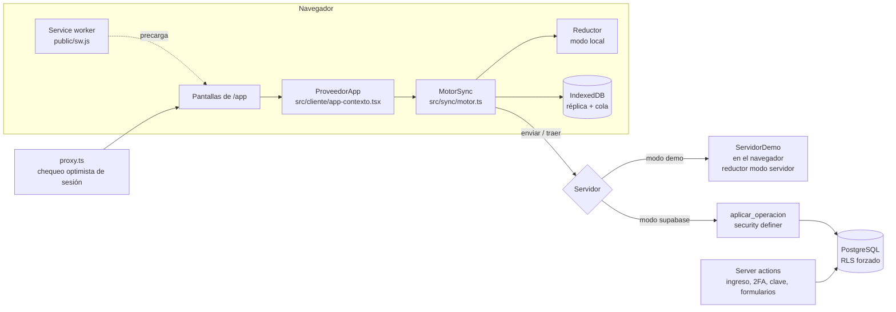

# Yunque — arquitectura

> Para un equipo que llega al código por primera vez. Estado: **demo funcional / piloto**.
> Las decisiones con su porqué están numeradas (D1–D40) en [`REPORTE.md`](REPORTE.md).

## En un minuto

- **Una sola app Next.js** con tres caras: el producto (`/app`), el sitio (`/`) y las presentaciones (`/inversores`, `/demo/[cliente]`).
- **Local-first**: la app lee de una réplica en el navegador (IndexedDB) y escribe **operaciones** idempotentes en una cola. Por eso el mostrador sigue vendiendo sin internet: no es un modo especial, es como funciona siempre.
- **Un solo reductor** (`src/sync/reductores.ts`) aplica las operaciones en el navegador (optimista) y en el servidor (autoritativo). En producción, la función SQL `public.aplicar_operacion()` implementa las mismas reglas.
- **Multiempresa con RLS** en Supabase/PostgreSQL: cada fila lleva `org_id`, RLS está activado y **forzado** en todas las tablas, los clientes solo pueden leer y toda escritura pasa por la función de operaciones.
- **Dos modos** (`src/lib/modo.ts`): `demo` (sin Supabase: todo en el navegador, servidor emulado, usuarios de prueba) y `supabase` (preparado, no probado contra una instancia real).

## Stack

| Capa | Elección |
|---|---|
| Framework | Next.js 16.4 (App Router, Turbopack, Cache Components, `proxy.ts`), React 19.3, TypeScript estricto |
| UI | Tailwind CSS 4, shadcn/ui 4 (Radix), lucide-react, motion |
| Datos en el navegador | Dexie (IndexedDB), Web Locks |
| Backend previsto | Supabase (PostgreSQL 18, Auth, RLS) |
| Sesión | JWT HS256 propio (`jose`) en cookie `httpOnly`; TOTP (`otpauth`) |
| Validación | zod 4 |
| Tests | Vitest 5, PGlite (PostgreSQL en WASM) para RLS, Playwright 1.64 |

## Carpetas

```
src/
  app/                 rutas (App Router)
    app/               el producto: tablero, inventario, mostrador, presupuestos, …
    ingresar/          ingreso, doble factor
    inversores/        presentación con clave
    demo/[cliente]/    demo comercial por prospecto
    panel/             panel interno del equipo (solicitudes de demo, con clave)
    api/               salud, sesión, errores, código 2FA de la demo
  components/
    app/               shell, tablero, tablas, escáner, paleta de comandos
    comercial/         carrito, ticket, selector de cliente, WhatsApp
    presentacion/      motor de presentaciones, kit, escenas, película del producto
    sitio/             secciones del sitio y demos interactivas
    marca/ base/ ui/   identidad, piezas comunes, shadcn
  dominio/             reglas de negocio puras (dinero, precios, ventas, caja, permisos, indicadores)
  sync/                motor de sincronización, reductor, almacenes, servidor demo
  cliente/             contexto de la app en el navegador, sesión local, demo embebida
  datos/demo/          generador determinístico de la empresa demo
  integraciones/       ARCA, Mercado Pago, WhatsApp, Mercado Libre (interfaces + emulados)
  config/              textos y números editables (precios, proyecciones, inversión, clientes)
  showcase/features.ts registro de funcionalidades (disponible / demo / próximamente)
  lib/                 auth, supabase, color, csv, monitoreo
supabase/migrations/   esquema, permisos, RLS, auditoría, operaciones, ingreso
tests/                 unit/, rls/ (PGlite), e2e/ (Playwright)
scripts/               capturas, sellos
```

## Diagrama de componentes



## Modos de ejecución

| | `demo` (hoy) | `supabase` (preparado) |
|---|---|---|
| Cuándo | sin `NEXT_PUBLIC_SUPABASE_URL`/`ANON_KEY` | con ambas variables |
| Datos | empresa demo generada en el navegador (semilla fija, se renueva cada día) | PostgreSQL con RLS |
| Servidor de sincronización | `ServidorDemo`: log en IndexedDB + Web Locks; varias pestañas = varios dispositivos | `public.aplicar_operacion()` |
| Ingreso | usuarios de prueba, contraseña `demo1234`, TOTP emulado | Supabase Auth + miembros |
| Límite de intentos | en memoria (una instancia) | `app.ingreso_permitido()` en la base |
| Solicitudes de "Pedir una demo" | base PostgreSQL local (PGlite en `.data/base-local`, con el shim de Supabase y las mismas migraciones) | tabla `solicitudes_demo` |

## Modelo de datos multiempresa

- **Organización → negocios → sucursales.** Todas las tablas de negocio llevan `org_id`; las claves foráneas son **compuestas** (`org_id`, `id`), así una fila nunca puede apuntar a otra empresa aunque alguien adivine un id.
- Tablas: `organizaciones`, `negocios`, `sucursales`, `miembros`, `permisos_rol`, `categorias`, `marcas`, `proveedores`, `productos`, `listas_precios`, `precios`, `stock`, `movimientos_stock`, `clientes`, `movimientos_cuenta`, `ventas`, `venta_items`, `pagos`, `presupuestos`, `presupuesto_items`, `ordenes_servicio`, `ordenes_compra`, `entregas`, `sesiones_caja`, `movimientos_caja`, `conteos`, `aumentos_precio`, `numeradores`, `auditoria`, `operaciones`, `operaciones_rechazadas`, `intentos_ingreso`, `solicitudes_demo`.
- **Permisos**: `miembros` (rol + sucursales permitidas) y `permisos_rol` (matriz). Funciones `app.tiene_permiso()` y `app.puede_sucursal()`. Dueño y administración exigen `aal2` (doble factor) **en la base**.
- **RLS**: activado y forzado en todas las tablas. `authenticated` solo tiene `SELECT` filtrado por organización (y sucursal donde aplica). Las columnas de costo (`productos.costo`, `venta_items.costo_unitario`) no se otorgan: se leen con `app.costos_productos()` si el rol tiene `costos.ver`.
- **Escrituras**: solo por `public.aplicar_operacion(op jsonb)` (security definer). Valida permiso y sucursal, aplica la operación en una subtransacción y registra en `operaciones`; los rechazos de negocio (SQLSTATE propio `YQ001`) van a `operaciones_rechazadas`.
- **Auditoría**: trigger `app.auditar()` en las tablas de negocio; `auditoria`, `movimientos_stock`, `movimientos_cuenta` y `operaciones` son de **solo agregar** (trigger que impide update/delete/truncate).
- **Privilegios explícitos**: la migración `0800_privilegios_api` revoca los privilegios que Supabase otorga por defecto a `anon` y `authenticated` sobre las tablas de `public` (también las futuras). El shim de los tests (`supabase/local/shim-supabase.sql`) replica ese comportamiento de Supabase para que los tests prueben el caso real.
- **Solicitudes de demo** (`solicitudes_demo`): el sitio inserta columnas puntuales como `anon`; el panel interno (`/panel`, con clave) lee y marca como contactadas con `service_role`, solo del lado servidor.
- **Importes en centavos** (enteros) en todo el sistema; cantidades con 3 decimales.

## Sincronización sin conexión

1. La pantalla llama `motor.ejecutar(tipo, datos)`. Se crea una operación con UUID, se valida y aplica con el reductor en **modo local** y queda en la **cola** (IndexedDB). La UI se actualiza al instante.
2. **Estado visible = base confirmada + operaciones pendientes reaplicadas** (rebase). Si llega algo del servidor, se reconstruye.
3. `sincronizar()` envía la cola propia en orden, trae lo confirmado desde el último `seq` y reaplica. Un solo ciclo a la vez; si se pide otro durante el ciclo, se da **otra vuelta** al terminar. Además: reintento cada 20 s, al volver la conexión y tras cada operación (con 120–250 ms de espera para agrupar ráfagas).
4. El servidor aplica el **mismo reductor en modo servidor**: asigna números definitivos (`#10482`) y fija precios/stock reales. Al reaplicar, el cliente usa los números que asignó el servidor (`ctx.asignado`).
5. **Idempotencia**: reenviar una operación ya confirmada devuelve el mismo resultado.

**Reglas de conflicto**

| Caso | Regla |
|---|---|
| Venta con stock insuficiente, precio distinto de lista, límite de cuenta excedido o caja cerrada | Se **acepta** con advertencia (la venta ya ocurrió en el mostrador) |
| Stock | Siempre por **deltas**, nunca "pisar" un valor |
| Dos puestos convierten el mismo presupuesto | Gana el primero; el segundo recibe `ya_convertido` |
| Cerrar una caja ya cerrada | Se rechaza |
| Fichas (cliente, producto) | Última escritura por campo, con aviso de conflicto |
| Transición inválida de servicio técnico | Se rechaza |

**PWA**: `public/sw.js` (escrito a mano) precarga las rutas de `/app` y sus chunks; estáticos cache-first; páginas de `/app` network-first con respaldo. La app abre y vende sin conexión aunque se recargue la página (probado en e2e).

## Sesión y acceso

- Cookie de sesión `httpOnly`, firmada (HS256, `SESION_SECRETO`), 12 h. Pre-sesión de 5 min para el doble factor.
- `src/proxy.ts`: chequeo **optimista** (sin sesión → `/ingresar`; dueño/administración sin `aal2` → verificar). La autorización real está en la base.
- `/inversores`: clave compartida + cookie propia de 8 h solo para esa ruta (D32–D33). `/demo/[cliente]`: pública por enlace, 404 para prospectos no configurados (D38).

## Integraciones

`src/integraciones/` define interfaces (`Facturador`, cobros, mensajería, marketplace) y hoy trae implementaciones **emuladas** que lo dicen en pantalla ("CAE emulado", "envío emulado"). Conectar una real es implementar la interfaz; las pantallas no cambian.

## Presentaciones

- `src/components/presentacion/motor.tsx`: escenario de 1920×1080 escalado; el scroll es la línea de tiempo; transiciones superpuestas de 0,75 s; autoplay, velocidades, teclado, enlace `#N`, precarga. Solo se anima `transform`, `opacity` y trazos SVG.
- Escenas: `escenas-inversores.tsx` (12) y `escenas-cliente.tsx` (7). Usan componentes reales de la app sobre una **demo embebida en memoria** (`src/cliente/demo-embebida.ts`), con el mismo motor de sincronización.
- Contenido editable en `src/config/` (`inversores.ts`, `inversion.ts` solo servidor, `proyecciones.ts`, `hoja-de-ruta.ts`, `precios.ts`, `clientes/`). Lo que falta va como `[COMPLETAR]` y se ve resaltado.

## Registro de funcionalidades y honestidad

`src/showcase/features.ts` es la fuente única del estado de cada función (`disponible` / `demo` / `próximamente`). Lo leen el sitio, la presentación y la demo comercial. `tests/unit/honestidad.test.ts` verifica que "Ferremix" solo aparezca en su configuración de demo comercial y que ningún prospecto se presente como cliente activo.

## Tests

| Suite | Qué cubre | Comando |
|---|---|---|
| Unitarios | dinero, precios, importación, permisos, motor de sincronización y conflictos, honestidad | `npm test` |
| RLS (PGlite) | aislamiento entre empresas, columnas protegidas, 2FA en la base, función de operaciones, matriz de privilegios de la API, solicitudes de demo; incluye controles negativos | `npm test` |
| E2E (Playwright) | ingreso y 2FA, venta de mostrador, presupuesto → venta, venta sin conexión con recarga, módulos por rol, sitio, presentaciones | `npm run build && npm run test:e2e` |
| Capturas | todas las pantallas en 1440×900 y 390×844 | `npm run build && npm run capturas` |
| Revisión | recorrido completo (sitio, cada usuario de prueba y cada módulo, presentaciones) con registro de errores | `npm run build && npx tsx scripts/revision.ts` |

`npm run verificar` corre typecheck + lint + tests + build.

## Deudas técnicas conocidas

| Deuda | Impacto | Camino sugerido |
|---|---|---|
| `aplicar_operacion` implementa 7 de 33 tipos de operación (venta, presupuesto guardar/convertir, ajuste, transferencia, cierre de caja, cobro) | En modo Supabase, el resto devuelve error temporal: la operación queda en la cola del dispositivo. Una operación que nunca se acepta bloquea su lugar en la cola (*poison message*) | Portar el resto desde `reductores.ts`; agregar "cuarentena" de operaciones tras N reintentos |
| Falta el adaptador `ServidorSupabase` del lado del cliente y la carga inicial (snapshot) desde la base | El modo Supabase no sincroniza todavía | Implementar `Servidor` con `rpc('aplicar_operacion')` y lectura paginada por `seq` |
| Modo Supabase sin probar contra una instancia real | Riesgo de diferencias de configuración (esquema `app` expuesto para las RPC de servicio, políticas de Auth) | Staging con Supabase y los mismos tests de RLS |
| Ids de operaciones del importador no son UUID | Inconsistente con el resto | Generar UUID por fila |
| Límite de intentos en memoria en modo demo; base local (PGlite) para las solicitudes en modo demo | No sirve con varias instancias ni en serverless | En producción, Supabase (ya preparado para ambos) |
| CSP con `'unsafe-inline'` | Menor defensa ante XSS | Nonces (implica render dinámico) — ver SEGURIDAD.md |
| En modo demo los datos viven en el navegador | La autorización por rol en la demo es solo de interfaz | Es intencional para la demo; en producción manda RLS |
| Cierre de conteos | Ajusta todas las diferencias de una vez, sin aprobación intermedia | Flujo de aprobación si el cliente lo pide |
| Performance móvil del sitio en Lighthouse simulado (77–89) | LCP real 0,27 s, pero el puntaje simulado no llega a 90 | Reducir hidratación y estilos de la página larga |
